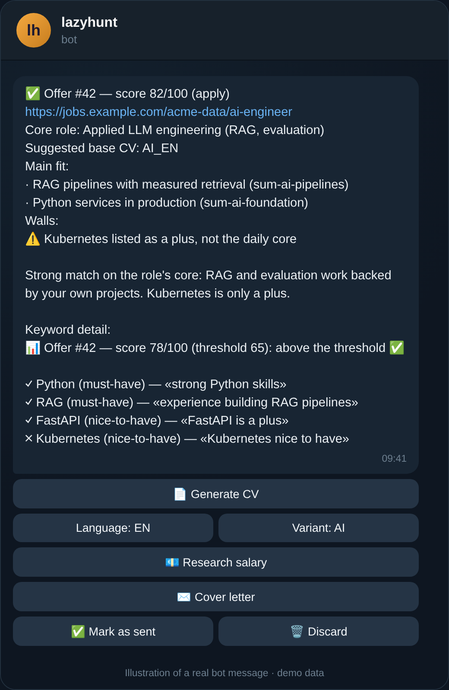
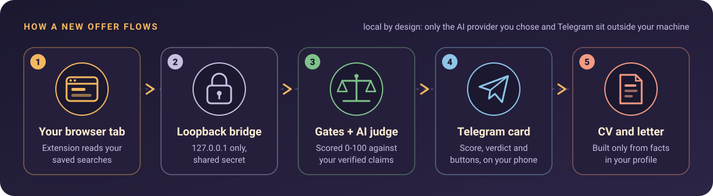

<p align="center">
  
</p>

<p align="center">
  <a href="https://github.com/SPujol98/lazyhunt/actions/workflows/ci.yml"></a>
  &nbsp;
  <a href="LICENSE"></a>
  &nbsp;
  
  &nbsp;
  
</p>

<p align="center">
  <b>A self-hosted job-search assistant that does the tedious scrolling for you.</b><br>
  It watches the job portals you choose from your own browser tab, scores every new offer<br>
  against a profile of facts you wrote, and drafts a tailored CV and cover letter, all from Telegram.<br>
  It never invents experience you don't have.
</p>

<p align="center">
  <a href="#quick-start"><b>Quick start</b></a>
  &nbsp;·&nbsp;
  <a href="#how-a-new-offer-flows"><b>How it works</b></a>
  &nbsp;·&nbsp;
  <a href="#telegram-commands"><b>Commands</b></a>
  &nbsp;·&nbsp;
  <a href="#customization"><b>Customization</b></a>
  &nbsp;·&nbsp;
  <a href="#troubleshooting"><b>Troubleshooting</b></a>
  &nbsp;·&nbsp;
  <a href="#privacy-and-security"><b>Privacy</b></a>
  &nbsp;·&nbsp;
  <a href="docs/getting-started.md"><b>Full setup guide</b></a>
</p>

> [!IMPORTANT]
> **Read this before enabling anything.**
> - **Portals.** The extension reads pages in your own logged-in browser tab, at low volume, only for the portals you enable. Some portals (notably LinkedIn) prohibit automated access or browser extensions in their terms, and your account could be restricted. Every portal is **off by default**: enable only those whose terms you have read and accept, and never redistribute collected listings. **You are responsible for compliance.**
> - **Claude Code.** lazyhunt never logs you in to Claude and never reads or stores Claude credentials. It runs the official, unmodified `claude` CLI that you installed and authenticated yourself. This is an independent project, not made, endorsed or sponsored by Anthropic; check Anthropic's terms and your plan's usage limits.
> - **Gmail** (optional) is read-only, through an OAuth client you create in your own Google Cloud project. Message bodies are never stored and nothing is sent to the author.
> - **Your responsibility.** lazyhunt is a personal tool provided as is, with no warranty (see the [license](LICENSE)). You choose what it searches, what it sends to your AI provider and what you send to employers; review every score, CV and letter before you use it.

## Why lazyhunt exists

I built lazyhunt to automate my own job search. Opening the same portals every day, scrolling the same lists and rewriting the same CV is exactly the kind of work a lazy person wants a machine to do, so I taught one to do it, with one rule it is not allowed to bend: it may only say about me what I can back up. It started as a tool for one person looking for work in Spain, and that still shows in a few places (see [limitations](#project-status-and-limitations)). Now it is yours to point at your own search.

## What this is

lazyhunt is two small pieces that live on your computer and talk to each other:

- **A browser extension** (Chrome, Brave or another Chromium-based browser) that, on a schedule, opens the saved searches you defined on the portals you enabled, in your own logged-in session, and picks out offers it has not seen before.
- **A Python bot** that receives those offers over a private, loopback-only connection, judges each one with the AI provider you configure, and talks to you through **Telegram**, the only interface.

There is no server, no account and no shared backend. Everything the bot knows about you comes from a **profile directory** of facts you wrote and approved.

**What you get on your phone:**

- A card for every new offer with a **0–100 score**, a verdict and the requirements you do and do not meet.
- One tap for a **tailored one-page CV** (Spanish, English or Catalan) and a **cover letter** built on your own base letter.
- **Tracking** of what you sent, follow-up reminders after 10 days of silence, an Excel export and an offline HTML dashboard.
- **Interview prep**: a bank of STAR stories from your profile and a preparation sheet per interview stage.
- A **kill switch** that stops everything automatic and survives restarts.

> [!NOTE]
> The Telegram interface follows **your system language** (English or Spanish); set `ui_language = "en"` or `"es"` to force one (see [Configuration](#configuration)). Your CVs and cover letters keep following the language of each offer.

## Quick start

🇪🇸 ¿Prefieres español? [Guía rápida en español](docs/guia-rapida-es.md)

From a fresh clone to your first scored offer takes about 20 minutes. Follow the steps in order: install, create your Telegram bot, run the setup wizard, start the bot and claim it, answer `/setup` in Telegram, load the extension, get your first offer. How to use the bot day to day comes last, once everything is set up. You do not write any profile file by hand: a short terminal wizard sets up the bot, and the bot itself then asks about you in Telegram (about 10 minutes). Every step below is also in the longer [getting-started guide](docs/getting-started.md).

> [!IMPORTANT]
> Don't let your coding assistant fill in your profile: use `/setup`. If you set lazyhunt up with Claude Code, Codex or another coding agent, it reads `AGENTS.md`, which tells it to leave `profiles/` to the bot.

### What you need

| You need | Why | How to check |
| --- | --- | --- |
| **[uv](https://docs.astral.sh/uv/)** (it brings **Python 3.12** itself) | Runs the bot and installs its dependencies | `uv --version` |
| **Chrome or Brave** (other Chromium-based browsers should work, untested) | Hosts the extension; keep it open while scans run | |
| **A Telegram account** | The bot's only interface; you create your own bot with [@BotFather](https://t.me/BotFather) | |
| **One AI provider** | Scores offers and writes letters | see below |
| &nbsp;&nbsp;↳ [Claude Code](https://docs.anthropic.com/en/docs/claude-code) *(default)* | Your own installed and logged-in CLI; no API key needed | `claude auth status` |
| &nbsp;&nbsp;↳ or [Codex CLI](https://github.com/openai/codex) | Your own installed and logged-in OpenAI CLI; no API key needed | `codex login status` |
| &nbsp;&nbsp;↳ or an Anthropic API key | Pay-per-use API | [docs/providers.md](docs/providers.md) |
| &nbsp;&nbsp;↳ or an OpenAI API key, or any OpenAI-compatible API | Gemini, OpenRouter, Groq, Mistral, or a local model with Ollama or LM Studio (free, runs on your machine) | [docs/providers.md](docs/providers.md) |
| *Optional:* a Google Cloud project | Read-only Gmail status proposals | [docs/gmail.md](docs/gmail.md) |

**Which AI?** Any of them follows the same instructions, so scoring, CVs and letters work with all. One difference: the cover letter's **web research of company facts** works only with Claude Code and Codex CLI, because they can browse the web; API models have no browsing tool, so with them that research is reported as not available instead of guessed. You pick the provider in the setup wizard, and can change it any time by running it again. Details and costs: [docs/providers.md](docs/providers.md).

**Operating systems.** Linux, macOS and Windows. CI runs the test suite on all three; lazyhunt is developed on Linux, so macOS and Windows get less day-to-day use. Commands below are written for a Unix shell; where a guide uses a Unix-only command, the Windows (PowerShell) equivalent is noted: `sha256sum <file>` is `Get-FileHash <file>`, and `chmod 600 <file>` can be skipped, because files under your user folder are private to your account by default.

**Installing uv.** If `uv --version` fails, install it with the official one-liner ([other methods](https://docs.astral.sh/uv/getting-started/installation/)), then open a new terminal:

```bash
# Linux and macOS
curl -LsSf https://astral.sh/uv/install.sh | sh
```

```powershell
# Windows (PowerShell)
powershell -ExecutionPolicy ByPass -c "irm https://astral.sh/uv/install.ps1 | iex"
```

You do not need to install Python yourself: lazyhunt pins Python 3.12 (`>=3.12,<3.13` in `pyproject.toml`), and `uv sync` downloads that version if your system does not have it.

### 1. Install

```bash
git clone https://github.com/SPujol98/lazyhunt.git lazyhunt
cd lazyhunt
uv sync
```

`uv sync` creates a virtual environment and installs everything; you do not need to activate anything, just prefix commands with `uv run`. Every command is `uv run lazyhunt <command>` (`uv run lazyhunt --help` lists them); the older `uv run cli.py …` and `uv run bot.py` forms still work.

### 2. Create your Telegram bot

Do this once, in the Telegram app, before the wizard:

1. Search for [@BotFather](https://t.me/BotFather) (blue check mark) and open it.
2. Send `/newbot`.
3. Type a name for your bot (any name, e.g. `My job hunter`).
4. Type a username that ends in `bot` (e.g. `myjobhunter_bot`).
5. BotFather replies with a token like `1234567890:AAH…`: copy the **whole** token. Keep it private.

Already have a bot? In @BotFather send `/mybots`, pick your bot and tap **API Token**.

### 3. Run the setup wizard

```bash
uv run lazyhunt init
```

The wizard only sets up the bot itself; everything about you comes later, in Telegram. It asks everything first, shows you a summary, and **writes nothing until you confirm**. Press Enter to skip any step; it is safe to run again and never replaces a value without asking.

1. **Bot language.** `auto` (default, your system language), `en` or `es`: the language of the Telegram bot, the command line and the dashboard. It is saved as `ui_language`, and the wizard itself continues in that language.
2. **Prerequisites.** Checks Python, `uv`, that `claude` is installed and logged in (only the yes/no is read) and whether `codex` is installed. If something is missing it tells you how to fix it and carries on.
3. **AI provider.** `claude_code` (default), `codex_cli`, `anthropic` or `openai_compatible`. The two CLIs use your own login and need no key. For `anthropic` it asks your API key (hidden). For `openai_compatible` it offers presets (OpenAI, Gemini, OpenRouter, Groq, Mistral, Ollama, LM Studio, or another URL), then the model (filled in from the preset) and the API key (hidden; for a local Ollama or LM Studio server any value works, and Enter sets a placeholder).
4. **Telegram.** Paste the whole bot token from step 2 (the input is hidden: nothing appears while you paste). The wizard repeats the @BotFather steps, asks again if the value is not a bot token (for example your AI key) and shows only its last 4 characters. You do **not** need your numeric user id: when the bot starts it prints a one-time code, and whoever sends `/start <code>` to the bot first becomes its only owner (see step 4). Already know your id? `uv run lazyhunt init --owner-id <id>` writes it.
5. **Bridge secret.** Generates a long random secret that the extension uses to talk to the bot. You never copy it: the bot gives the extension a one-time pairing code (step 6).
6. **Profile directory.** Creates `profiles/me` (gitignored). Choose **empty** (the default and the recommended choice): the bot then starts in *setup mode* and builds the profile with you through `/setup`. The other choices are a skeleton with placeholders to fill in by hand, or a copy of the fictional demo profile to try things first.
7. **Gmail.** Only a pointer to [docs/gmail.md](docs/gmail.md); it stays off.

Where things end up:

| File | Contents |
| --- | --- |
| `.env` (mode 600) | Secrets: `CVA_TELEGRAM_TOKEN`, `CVA_BRIDGE_SECRET`, and the API key if your provider needs one (`ANTHROPIC_API_KEY` or `CVA_LLM_API_KEY`) |
| `config.local.toml` | Settings: `ui_language`, `llm_provider` (with `llm_base_url` and `llm_model` for `openai_compatible`), `profile_dir`; later `owner_telegram_id` (written when you pair with `/start <code>`); `enabled_portals` only if you set it by hand (see [Configuration](#configuration)) |
| `profiles/me/` | Your profile (empty until `/setup`) |

> [!TIP]
> Want to look around before answering anything about yourself? Pick the demo profile in the wizard (or set `profile_dir = "profiles/demo"`). It belongs to a fictional person and shows the format of every file.

### 4. Start the bot and claim it

```bash
uv run lazyhunt bot
```

It first checks the bot token with Telegram. If Telegram rejects it, the bot prints one line and stops (`Telegram rejected the bot token. Check CVA_TELEGRAM_TOKEN in .env — it must be the token @BotFather gave you.`); the token itself is never printed or logged.

**The first time**, the terminal shows a one-time code (and a `t.me` link that sends it for you):

```text
lazyhunt has no owner yet. To become its owner, send this message to your bot in Telegram:

    /start ABCD-EFGH
```

Send exactly that to your bot. It answers that you are now its owner and saves your id as `owner_telegram_id` in `config.local.toml`; from then on it answers **only** you. Until then it ignores every message, and a wrong code gets no answer. The code works once, for 30 minutes, and after 5 wrong tries it stops working: restart the bot for a new one. It is shown only in a terminal, never in a log file: if you run the bot as a service from the start, run `uv run lazyhunt bot` once in a terminal first.

With an empty profile the bot is in **setup mode**: only `/help`, `/start`, `/setup` and `/connect` work until your profile is complete, and `/start` tells you to run `/setup`, the next step.

The bot runs as long as that terminal stays open. To keep it running in the background, or to start it when you log in (systemd on Linux, launchd on macOS, Task Scheduler on Windows), see [docs/running.md](docs/running.md).

### 5. Answer `/setup` in Telegram

Send `/setup` (`/configurar` in Spanish). The bot asks one question per message, with buttons wherever the answer is a choice; it takes about 10 minutes:

- the bot language, your contact details and the positions you want (the built-in AI and Backend families, or your own job titles);
- your level, spoken languages, main skills, experience and education;
- work modes (remote, hybrid, on-site), the city and country you want to work in, and an optional minimum salary;
- the languages an offer may be written in;
- your base CVs as PDF files, one per position and language (you can skip them and add them later).

Every step has **Back** and **Cancel**, and nothing is saved until you press **Confirm** on the summary. Confirm is all or nothing: if anything fails, every file is put back as it was and you can simply press Confirm again. It writes `preferences.toml`, `profile.toml`, a minimal `claims.json` with only what you stated, the judge files and your base CVs, and switches the bot to normal mode on its own. The full list of questions and files: [docs/onboarding.md](docs/onboarding.md).

You can change any answer later (see [step 8](#8-day-to-day)).

### 6. Load the extension

1. Open `chrome://extensions` (Brave: `brave://extensions`), turn on **Developer mode**, click **Load unpacked** and select the `extension/` folder of this repository. The extension is not in a store; you load it straight from the code you can read.
2. Send `/connect` (`/conectar`) to the bot: it answers a one-time pairing code. In the extension's **Options › Schedule and bot**, type it under **Pair with code** and press **Pair**: the bridge URL (`http://127.0.0.1:8765/bridge` by default) and the secret are filled in and saved for you. The code works once, for 10 minutes; send `/connect` again for a new one. (Typing the secret by hand still works: it is `CVA_BRIDGE_SECRET` in `.env`, and the wizard can show it once at the end.)
3. In **Options › Portals**, switch on the portals you want to use. This is the only place where a portal is enabled (`/setup` does not ask for portals). Each switch shows the portal's terms warning and asks the browser for permission to that single site.
4. In **Options › Searches**, press **Suggest from my profile** (until you do, the popup says "No searches yet" and **Check now** has nothing to scan). It proposes searches built from your answers: the roles of each position you chose, in your city when you accept on-site or hybrid work, plus a remote search when you accept remote work. Tick the ones you want, or add your own (keywords and location), and in each search tick the portals it should run on: a search runs only on the portals you tick in it.

Supported portals today: LinkedIn, InfoJobs, Indeed, Tecnoempleo, JobFluent, Manfred, Adzuna and foorilla (*experimental*: its search filter has not been verified on the live site, its cards carry no company name, and it is a worldwide feed, so expect to rely on the location gate and title filters). Status and caveats per portal: [docs/portals.md](docs/portals.md#portal-status).

<p align="center">
  <br>
  <sub>Options: enable portals, then add searches. (Demo data.)</sub>
</p>

<p align="center">
  <br>
  <sub>Options › Profile: change what you answered in <code>/setup</code> at any time. (Demo data.)</sub>
</p>

### 7. Get your first offer

You do not have to wait for the schedule:

- Click **Check now** in the extension's toolbar popup to run a round immediately, or
- paste any offer link into Telegram with `/analyze <url>`.

<p align="center">
  <br>
  <sub>The toolbar popup: what is being watched and a <b>Check now</b> button. (Demo data.)</sub>
</p>

A card arrives with the score, the verdict, what you match and what you do not, and buttons for the next steps. After that, rounds run on their own every **60 minutes** by default (adjustable in **Options › Schedule and bot**; the extension warns below 30).

<p align="center">
  <br>
  <sub>An offer card. (Illustration of a real bot message, demo data.)</sub>
</p>

### 8. Day to day

Everything is set up. From here on, this is how you use lazyhunt.

**The offer card.** On an offer card (button names are shown in English here; with `ui_language = "es"` the bot shows the Spanish name in brackets):

- **📄 Generate CV** (*Generar CV*) builds a one-page PDF. Switch the language (ES/EN/CA) and the variant on the card first if you like, or type `/cv 42 BACKEND en`.
- **✉️ Cover letter** (*Carta de presentación*) keeps your approved base letter word for word and writes only the parts that change per offer (why this company, why this role). It researches the company on the web and shows every fact with its source URL, so you can check it. Details: [docs/cover_letters.md](docs/cover_letters.md).
- **✅ Use this one** (*Usar esta*) saves the letter on the offer and also sends it as a one-page PDF (same font as your CVs, next to the offer's CV), for portals that want the letter as a file; `/basecover` (`/cartabase`) sends the generic letter as a PDF too.
- **✨ Adapt to this offer** (*Adaptar a esta oferta*) appears under a delivered CV only when lazyhunt created that base CV in `/setup` (not for an uploaded PDF or your own hand-made PDFs). It proposes a few small changes starting from the base CV: reorder items, feature up to 3 of your skills in the headline, and swap a word for the offer's wording for something already on your CV. A word that is not an approved synonym yet is marked 🆕 *new synonym* and is your call: pressing **✅ Use this CV** saves it to `synonyms.json`, so it applies on its own next time and also helps match offers (never a tool, technology, company, title, degree or number). Nothing is invented and nothing is final until you press **✅ Use this CV** (*Usar este CV*); **↩️ Remove change N** drops one change and **Discard** keeps the base CV. The adapted PDF is a separate file (`…_adapted_<id>.pdf`) next to the base one; **🔄 Redo CV** still sends the base. Details: [docs/onboarding.md](docs/onboarding.md#adapting-a-created-cv-to-an-offer).
- **✅ Mark as sent** (*Marcar enviada*, or `/sent 42`) records that you applied.
- **🔎 On LinkedIn / On Google / On InfoJobs** (*En …*), the card's last row, open a search for the same offer (title + company) on another site, so you can apply there instead; the offer's own portal is left out (an InfoJobs offer gets Indeed instead).

**Base CVs.** `/cvs` lists your base CVs (position × language) and what each is made of; its buttons send the PDF and, for the ones lazyhunt created, change the template or rebuild them. `/setup cvs` (`/configurar cvs`) adds the ones you skipped.

**Tracking.**

- Let rounds run in the background; review the cards that arrive.
- `/status` (`/estado`) lists your last 10 offers; `/status 42` shows one. The match column is the score at send time, else the analysis score (the judge score in hybrid mode), and `—` only for offers not analysed yet.
- When a company answers, use `/outcome <id>` to record progress. Interviews and rejections you record can become **calibration examples** (`/calibration`), so the score learns what actually works for you.
- Before an interview, `/prep <id>` gives you a preparation sheet and `/star` keeps your STAR stories.
- `/panel` sends an offline HTML dashboard of everything so far.
- Going on holiday? `/pause` stops scans, automatic analysis and Gmail; `/resume` resumes. The extension popup has the same **Pause** button.

**Change your profile** with `/setup <section>` (for example `/setup salary`), which re-asks only that part prefilled with your current answers, or in the extension's **Options › Profile** tab. For advanced, hand-written profiles (projects, cover-letter base, voice sample, role families), see [profiles/README.md](profiles/README.md). Don't let your coding assistant fill in your profile: use `/setup`.

Every command is in [Telegram commands](#telegram-commands) below, and `/help` lists them in the bot.

## Telegram commands

Send `/help` at any time for the full list with an example of each. The ones you will use most (with `ui_language = "es"` the bot shows the Spanish names, and both spellings always work):

| Command | What it does |
| --- | --- |
| `/analyze [url]` | Score an offer from a link or pasted text |
| `/cv <id> [AI\|BACKEND] [es\|en\|ca]` | Generate the tailored CV PDF |
| `/status [id]` | The last 10 offers, or one offer's status |
| `/sent <id>` · `/outcome <id>` | Record an application and how it is going |
| `/panel` | Offline HTML dashboard with metrics, charts and a filterable table |
| `/prep <id>` · `/star` | Interview preparation and your STAR story bank |
| `/pause` · `/resume` | Pause or resume every automatic task |
| `/setup [section]` | Guided profile setup, or only one part of it (`/setup salary`) |

<details>
<summary><b>Full command reference</b></summary>

<br>

| Group | Command | What it does |
| --- | --- | --- |
| Analyze | `/analyze [url]` | Scores an offer against your profile. Without a link, it asks for the text. |
| | `/rescue <id>` | Re-sends the full card of an offer that was discarded, without touching its score. |
| CVs and letters | `/cv <id> [AI\|BACKEND] [es\|en\|ca]` | CV PDF for offer `#id`. Role and language are optional and chosen automatically when missing. |
| | `/basecover [es\|en\|ca]` (or `/base`) | Your generic letter for portals, with no specific offer, ready to copy. |
| Tracking | `/status [id]` | Without an id, the last 10 offers; with an id, that offer's status. |
| | `/sent <id>` | Records that you sent the application for offer `#id`. |
| | `/outcome <id>` | History of a sent application plus buttons to record progress. After 10 days without news it proposes a follow-up, which you send yourself. |
| | `/calibration` | The real outcomes that calibrate the score; each one can be turned off. |
| | `/skip` | Skips the feedback note the bot asks for after an outcome. |
| | `/export` | Excel file with only the applications you sent. |
| | `/panel` | Offline HTML dashboard: metrics, charts, alerts, a filterable table and discarded offers. |
| Beacons and searches | `/keywords [profile]` | The keywords seen in offers and how often, optionally filtered by profile. |
| | `/beacons` | Every watched search ("beacon") with its status and last check. |
| | `/searches` | Per watched search over 14 days: rounds, offers found, new ones and the last failure, zero-new first, to spot searches worth removing (counts accumulate from this version on). |
| | `/beacon resume\|disable <id>` | Resumes a paused beacon or disables it. |
| Interviews | `/star` | Builds your STAR stories (situation, task, action, result) and lists them to view, edit or delete. |
| | `/prep <id>` | Pick a stage (HR, technical, final) and get an HTML sheet with topics, gaps, STAR stories, salary and questions. |
| Other | `/pause` | Stops everything automatic; `/analyze` keeps working. |
| | `/resume` | Turns back on what was paused. |
| | `/setup [section]` | Guided setup of your profile, or only one section of it, prefilled with your current answers: [docs/onboarding.md](docs/onboarding.md). |
| | `/help` (or `/start`) | Commands and buttons. |

Seven commands have a Spanish name that also works and is shown when `ui_language = "es"`: `/status` is `/estado`, `/rescue` is `/rescatar`, `/calibration` is `/calibracion`, `/pause` is `/pausa`, `/resume` is `/reanudar`, `/basecover` is `/cartabase` and `/setup` is `/configurar`. Card buttons follow the same language (for example **Generate CV** or **Generar CV**). `/help` explains every one of them.

The same service is scriptable from the command line:

```bash
uv run lazyhunt --help
uv run lazyhunt analyze <id>
uv run lazyhunt judge-eval      # measure the judge against labelled offers (--details: per offer)
```

</details>

## How a new offer flows

<p align="center">
  
</p>

1. **Your tab, your pace.** On each round the extension opens your saved searches on the portals you enabled, in your own logged-in session, at low volume, and keeps the offers it has not delivered before.
2. **A private hand-off.** New offers are sent to the bot over a bridge that listens on `127.0.0.1` only and rejects anything without the shared secret. With no secret set, no port is opened at all.
3. **Judged against you, not against hype.** The bot stores each offer in a local SQLite database, extracts its requirements with your AI provider, runs deterministic gates (location, language, eligibility, and "walls": requirements you cannot back), and asks the AI judge for a 0–100 score and verdict against your claims.
4. **A card in Telegram.** You get the score, the verdict, what matches and what does not, and buttons for what to do next.
5. **Documents only from your facts.** CVs and letters are rendered locally from your own base CVs and letter. A claim that is not in your profile never appears in them.

<details>
<summary><b>What makes it different</b></summary>

<br>

- **It reads in your own tab.** No scraping server, no shared accounts and no stored portal passwords: the extension sees what you would see when you are logged in, only on the portals you switched on. Why: [ADR 0001](docs/adr/0001-browser-extension-in-the-users-tab.md), [ADR 0005](docs/adr/0005-portals-opt-in-with-terms-warnings.md).
- **Honest by design.** Requirements you cannot honestly claim stay unmatched. The CV and letter engines may only use facts from your profile, and company facts in a letter come with their source URL.
- **Hard gates before soft judgment.** Location, language, eligibility and walls are checked by deterministic code, so an AI score cannot talk its way past them.
- **It learns from what happened, not from guesses.** Interviews and rejections you record become approved calibration examples for the judge.
- **Your own AI, your own bill.** By default it uses the Claude Code CLI you already pay for and never forwards `ANTHROPIC_API_KEY` to it, so you are not silently switched to API billing. Why: [ADR 0002](docs/adr/0002-users-own-claude-code-cli-as-default-provider.md).
- **Your data stays a file.** One SQLite database on your disk ([ADR 0003](docs/adr/0003-sqlite-local-storage.md)); Gmail, if you want it, goes through your own OAuth client ([ADR 0004](docs/adr/0004-bring-your-own-google-oauth-client.md)).
- **One big off switch.** `/pause` stops scans, automatic analysis and Gmail at once and stays off across restarts.

The full picture, component by component: [docs/architecture.md](docs/architecture.md).

</details>

<details>
<summary><b>Glossary</b></summary>

<br>

| Term | Meaning |
| --- | --- |
| **Beacon** | One watched search on one portal. A search you add in the extension becomes one beacon per portal you tick; `/beacons` lists them with their status. |
| **Claims** | Your verified facts, in `<profile>/claims.json`. The only source a CV or a letter may use. |
| **Gates** | Deterministic checks the bot runs before the AI judge: location, language and eligibility. |
| **Walls** | Requirements you cannot back with a claim. A *hard* wall (or a failed gate) forces a discard; a *soft* wall is shown on the card with a warning. |
| **Judge** | The AI step that reads an offer against your claims and gives the 0–100 score, the verdict and the rationale. |
| **Anchors** | A few example offers with the score you would give them, in `<profile>/judge/anchors.md`; they teach the judge your taste. |
| **Calibration** | Real outcomes you recorded (interviews, rejections) that you approved as examples for the judge; `/calibration` lists them. |
| **Setup mode** | How the bot starts while the profile is incomplete (after `cli.py init` with an empty profile): only `/help`, `/start` and `/setup` work. Confirming `/setup` switches it to normal mode without a restart. |
| **Role family** | A kind of job you search for (built in: AI and backend), with its own base CVs, title filter and threshold: [docs/role-families.md](docs/role-families.md). |

</details>

## Configuration

Settings are layered: code defaults, then `config.toml`, then `config.local.toml` (personal, gitignored), then `CVA_*` environment variables. Secrets are read from the environment only. [`config.example.toml`](config.example.toml) documents the safe public defaults; to configure by hand instead of using the wizard, copy it to `config.local.toml` and `.env.example` to `.env`.

| Setting | Default | What it does |
| --- | --- | --- |
| `llm_provider` | `claude_code` | `claude_code`, `codex_cli`, `anthropic` or `openai_compatible` ([docs/providers.md](docs/providers.md)) |
| `profile_dir` | unset | Directory with your claims, base CVs, voice and preferences |
| `enabled_portals` | unset | Restrict which portals the bot accepts; unset lets the extension decide |
| `match_mode` | `keyword` (`cli.py init` writes `hybrid`) | `hybrid`: the AI judge scores each offer and decides what reaches Telegram (recommended; `cli.py init` sets it on a new install). `keyword`: offline keyword scoring with no AI, a fallback that rarely reaches the threshold |
| `threshold` | `65` | Minimum score for the top-choice badge |
| `gmail_enabled` | `false` | Optional read-only Gmail sync ([docs/gmail.md](docs/gmail.md)) |
| `paused` | `false` | Initial state of the kill switch until `/pause` or `/resume` is used |
| `ui_language` | `auto` | Language of the Telegram bot, the CLI and the dashboard: `auto` (your system language: Spanish if it starts with `es`, English otherwise), or `en` / `es` to force one. CVs and letters follow each offer's language, not this setting |

## Customization

Everything that describes you or your search is yours to change, and none of it needs code. `<profile>` is your profile directory (`profiles/me` after `cli.py init`); the fictional [`profiles/demo`](profiles/demo) shows every file's format.

| To change | Where | Notes |
| --- | --- | --- |
| Searches: keywords, location, portals | Extension › Options › Searches | One search runs on every portal you enabled |
| Title filters (include / exclude) | Extension › Options › Title filters | A cheap pre-filter before the AI sees an offer; can be turned off per search |
| Your `/setup` answers: positions, level, languages, skills, experience, location, salary, offer languages | Extension › Options › Profile, or `/setup <section>` in the bot | Saved through the bot with the same checks as `/setup`; hand-written claims are shown but never changed: [docs/onboarding.md](docs/onboarding.md#change-it-later) |
| How the AI judges offers for you | `<profile>/judge/facts.md`, `anchors.md`, `rubric_persona.md` | Plain text: facts about you, a few example offers with the score you would give, and how to weigh requirements. `cli.py init` creates them with instructions |
| Your experience (the only source for CVs and letters) | `<profile>/claims.json`, `<profile>/masters/`, your base CVs | A claim that is not here never appears in a CV or a letter |
| Cover-letter voice and emphasis | `<profile>/voice.md`, `<profile>/preferences.toml` `[cover_letter]` | |
| AI provider and model | `llm_provider` in `config.local.toml`; the API key in `.env` | Your own Claude Code or Codex CLI login (no key), an Anthropic API key, or any OpenAI-compatible endpoint (OpenAI, Gemini, OpenRouter, Groq, Mistral, Ollama, LM Studio): run `cli.py init` again or see [docs/providers.md](docs/providers.md) |
| Role families: your own kinds of job (CV variants, filters, thresholds) | `<profile>/preferences.toml` `[families.<id>]`, `<profile>/cv_base_pdfs/manifest.json` | Frontend, marketing, nursing... with no code: [docs/role-families.md](docs/role-families.md) |
| Score threshold, match mode, accepted portals | `config.local.toml` | See [Configuration](#configuration) |
| A portal that is not supported yet | Ask a coding agent | Give a coding agent (Claude Code, Codex, …) a saved results page and ask it to follow [docs/adding-a-portal.md](docs/adding-a-portal.md): it scaffolds the adapter and its tests with `scripts/new_portal.py`. Reference: [docs/portals.md](docs/portals.md) |

## Tips for better results

- **Write claims you can defend in an interview.** The judge and the CV engine can only be as good as `claims.json`; vague claims give vague scores.
- **Spend ten minutes on `judge/anchors.md`.** A few real offers with the score *you* would give them teach the judge your taste faster than anything else.
- **Record outcomes.** Every interview or rejection you log with `/outcome` is a chance to calibrate the score.
- **Start with one or two portals** and a couple of searches, check the cards for a few days, then widen.
- **Read every CV and letter before sending it.** lazyhunt drafts; you decide.

## Troubleshooting

<details>
<summary><b>The bot does not answer in Telegram</b></summary>

<br>

- Check that it is running: the terminal where you started it, or your service (see [docs/running.md](docs/running.md)).
- `CVA_TELEGRAM_TOKEN` in `.env` must be the token BotFather gave you; after `/revoke`, paste the new one and restart.
- Has it got an owner? While `owner_telegram_id` is unset (`0`) the bot ignores every message except `/start <code>` with the code printed in its terminal (the log says `waiting for the owner claim`; started without a terminal it prints no code and says to run `uv run lazyhunt bot` once in a terminal). After 5 wrong codes, or 30 minutes, restart it for a new code. Once paired, it answers only the id saved in `owner_telegram_id`.
- `uv run lazyhunt check`, run in the lazyhunt folder, loads your settings and profile without Telegram and runs any due beacons stored in the bot; if a setting is wrong, the error names it.

</details>

<details>
<summary><b>The AI stopped answering</b></summary>

<br>

When the AI provider has no valid login or key (Claude Code login expired or not logged in, Codex not logged in, a rejected API key) or a usage limit is reached (the 5-hour limit, a monthly quota), the bot **pauses the automatic analysis** instead of failing offer by offer:

- New offers are kept pending, with no error cards.
- You get **one** message with the cause and the fix, and two buttons: **🔄 Check now** (tests the AI at once) and **▶️ Resume** (ends the pause without testing).
- The bot tests the AI every 15 minutes (or at the reset time the usage-limit message gives) and resumes by itself: "✅ AI is back, analysing N pending offers". The offers that failed just before the pause are analysed again too.
- `/status` and `uv run lazyhunt check` show the pause while it lasts; `/analyze` answers with the same message.

The fix depends on the provider:

- **Claude Code:** run `claude auth login` on the bot's machine. For a bot that runs unattended (a service), run `claude setup-token` and put the token in `.env` as `CLAUDE_CODE_OAUTH_TOKEN=...`, then restart the bot. See [docs/providers.md](docs/providers.md).
- **Codex CLI:** run `codex login`.
- **Anthropic API / OpenAI-compatible:** check `ANTHROPIC_API_KEY` or `CVA_LLM_API_KEY` in `.env`, and the provider's billing page for a quota.

Short outages (timeouts, HTTP 5xx, a plain HTTP 429) do not pause anything: the offer is retried later as before.

</details>

<details>
<summary><b>The bot only answers <code>/setup</code>, or <code>/setup</code> says Confirm failed</b></summary>

<br>

- **Setup mode.** While the profile is incomplete the bot answers only `/help`, `/start` and `/setup`; `/start` tells you to run `/setup`. Finish `/setup` and press **Confirm**: the bot switches to normal mode right away. If it says a file is broken, it names the file and the error: fix that file (or run `/setup` again) and send any message.
- **"Could not save your answers".** Confirm is all or nothing, so when it fails the reply says nothing was changed: every file is back as it was and your uploaded PDFs are kept. The reply names the file and the cause (a hand-edited `preferences.toml` or `config.local.toml` that no longer loads is the usual one). Fix it and press **Confirm** again; there is no need to answer or upload anything twice.
- **"Some files could not be put back".** Rare (a full disk or a permission change mid-write). Check the profile folder: each rewritten TOML file keeps its previous version as `<name>.bak`.

</details>

<details>
<summary><b>The extension does not connect ("Bot not connected")</b></summary>

<br>

- The bot must be running, and the bridge URL in **Options › Schedule and bot** must be exactly `http://127.0.0.1:8765/bridge`.
- Pair again: send `/connect` to the bot and type the code under **Options › Schedule and bot › Pair with code**. "The code is wrong, used or expired" means exactly that: ask for a new one (a code locks after 5 wrong tries).
- A typed secret must be the same as `CVA_BRIDGE_SECRET` in `.env`. A wrong secret is answered with HTTP 401 ("The bot rejected the secret." when you press **Suggest from my profile**, "The bot rejected the secret: pair again…" after **Check now**). Without a secret in `.env` the bot opens no port at all (`/connect` says the bridge is off).
- **Check now** stops at once and says why when it cannot scan: the bot is not reachable, the secret was rejected, the bot is still in `/setup`, there are no searches, or no portal is enabled and allowed. The popup also shows the outcome of the last round. **Pause** stops a round in progress.
- If another program already uses port 8765, the bot log says `bridge bind failed on 127.0.0.1:8765`. Set another `bridge_port` in `config.local.toml`, restart the bot, and use the same port in the bridge URL.

</details>

<details>
<summary><b>Offers are not scored: Claude Code is not logged in</b></summary>

<br>

Run `claude auth status`. If it says you are logged out, run `claude auth login` (or start `claude` and type `/login`). If it works in your terminal but not in a background service, the service cannot find `claude`: see the `PATH` notes in [docs/running.md](docs/running.md), or set `claude_code_path` in `config.local.toml` to its full path. Other providers: [docs/providers.md](docs/providers.md).

</details>

<details>
<summary><b>An offer the extension found has no card yet</b></summary>

<br>

With `match_mode = "hybrid"`, when the AI judge is temporarily unavailable (HTTP 503 "high demand", 429, a timeout) the offer stays pending and the bot judges it again later: after about 10 minutes, 30 minutes, 2 hours and 6 hours. The card arrives when the judge answers. If it never does, the offer is scored by keywords, the card says the LLM judgment failed and the offer's notes say the AI judge was unavailable. See [docs/providers.md](docs/providers.md).

</details>

<details>
<summary><b>A scan finds nothing, or a health alert arrives</b></summary>

<br>

- Open the search in your browser by hand: you may have been logged out, shown a captcha, or the search really has no new offers.
- Title filters and the location gate can drop everything; try a broader search, or turn the title filter off for that search in the extension's Options.
- A **⚠️ beacon** alert means a beacon that used to return offers now returns none, or its offers arrive without a company, or that its last scans came back empty without the portal's "no results" page (the alert names the portal when the beacon's name or search says which one). The portal probably changed its pages or blocked you for a while; open it by hand, and see [docs/portals.md](docs/portals.md) for each portal's known limits.

</details>

<details>
<summary><b>Where the logs are</b></summary>

<br>

- **Bot:** the terminal you started it in, or your service's log: `journalctl --user -u lazyhunt` (Linux), `data/bot.log` (macOS and Windows, with the setups in [docs/running.md](docs/running.md)).
- **Extension:** `chrome://extensions` › lazyhunt › **service worker** opens its console.

</details>

## Updating

```bash
cd lazyhunt
git pull
uv sync
```

Then restart the bot ([docs/running.md](docs/running.md) has the command for each setup): database migrations run on their own when it starts. Finally, open `chrome://extensions` and press the reload button on the lazyhunt card, so the browser picks up the new extension code. Your `.env`, `config.local.toml`, `data/` and `profiles/me/` are gitignored, so an update never touches them.

## Uninstalling

1. Stop the bot, and remove its service if you set one up ([docs/running.md](docs/running.md) has the command for each system).
2. Remove the extension: `chrome://extensions` › lazyhunt › **Remove**.
3. Keep what you want from the lazyhunt folder (your profile in `profiles/me/`, the database `data/app.db`), then delete the folder.
4. Revoke what you granted: the Telegram token with BotFather (`/revoke`, or `/deletebot` to delete the bot), the Gmail app at [myaccount.google.com/permissions](https://myaccount.google.com/permissions) if you enabled Gmail, and any API key you created for lazyhunt. Claude Code is your own install; lazyhunt stored nothing of it.

## Privacy and security

- **Local first.** Offers, scores and history live in a local SQLite database. The bridge listens on `127.0.0.1` only and rejects requests without the shared secret.
- **What leaves your machine:** offer text and the relevant parts of your profile go to the AI provider you configured; card text goes to Telegram; company research uses public web pages; Gmail is read only if you enable it.
- **Only you can talk to the bot.** It answers your numeric Telegram id and nobody else, over long polling (no webhook, no public endpoint).
- **Secrets** (`CVA_TELEGRAM_TOKEN`, `CVA_BRIDGE_SECRET`, API keys) are read from the environment only; values placed in TOML files are ignored.
- **No accidental API billing.** The `claude` child process does not inherit `ANTHROPIC_API_KEY` unless you set `claude_code_pass_api_key = true`.
- **Revoking access:** delete the Gmail token file and remove the app at [myaccount.google.com/permissions](https://myaccount.google.com/permissions); revoke the Telegram token with BotFather (`/revoke`); disable portals in the extension's Options, which also drops the browser permission; `claude auth logout` logs the CLI out (lazyhunt stores nothing of it).

Found a security problem? Please follow [SECURITY.md](SECURITY.md) instead of opening a public issue.

## Project status and limitations

lazyhunt is an early release (`v2.0.0-beta.9`, a pre-release for testers; see the [changelog](CHANGELOG.md)) and was built first for one person's job search in Spain.

- Location rules ship for Catalonia and Spain; other regions need their own data.
- Portal adapters depend on each site's page structure and can break when a site changes.
- AI scores are not deterministic; the gates and the calibration set keep them consistent, not exact.
- `cli.py init` and `/setup` cover the first configuration and the everyday profile; finer settings (projects, cover-letter base, voice sample, title filters, thresholds) are edited by hand (see [Customization](#customization)). `/setup` does not read your CV yet: claims about projects are added by hand for now.
- The extension is loaded unpacked from this repository; it is not published in a browser store.
- The CV engine renders with Carlito (SIL OFL 1.1, metric-compatible with Calibri), shipped in `cvgen/fonts/carlito/`. If you own Microsoft's Calibri, put `calibri.ttf`, `calibrib.ttf`, `calibrii.ttf` and `calibriz.ttf` in `cvgen/fonts/` and set `cv_font = "calibri"`; Calibri is never redistributed.

### Roadmap

What is planned next, in no fixed order:

- **More regions.** Location rules are pluggable; packs beyond Catalonia and Spain.
- **Custom role families on par with the built-ins.** The stack wall and the skill-based search suggestions work for `ai` and `backend` today; custom families get the rest.
- **More portals.** New adapters are a skill away (see [Customization](#customization)); contributions are welcome.

<details>
<summary><b>Repository layout</b></summary>

<br>

```text
lazyhunt/
├── bot.py                 # Telegram bot: the entry point you run
├── cli.py                 # Same service from the command line, plus the `init` wizard
├── cva/                   # The engine
│   ├── bridge.py          #   loopback endpoint the extension talks to
│   ├── service.py         #   JobService, the seam every entry point uses
│   ├── match/             #   extraction, gates, AI judge, cover letters
│   ├── cvgen/             #   CV rendering
│   ├── tracker/           #   SQLite storage, Excel export
│   ├── gmail/             #   optional read-only Gmail sync
│   ├── commands.py        #   Telegram commands and /help text
│   └── llm.py             #   AI provider seam (Claude Code, Anthropic, OpenAI-compatible)
├── extension/             # Chromium (Manifest V3) extension (load unpacked)
│   ├── core/              #   rounds, scheduling, delivery
│   └── portals/           #   one adapter per portal
├── profiles/demo/         # Fictional example profile: the format reference
├── cvgen/fonts/carlito/   # Bundled CV font
├── docs/                  # Guides, architecture, decision records (adr/)
├── tests/                 # Test suite (no network needed)
└── config.example.toml    # Documented public defaults
```

</details>

## Development

```bash
uv run pytest -q                                   # test suite, no network needed
uv run mypy --strict cva                           # type checking
uv run ruff check cva tests bot.py cli.py scripts  # lint
```

Tests use fake AI clients and temporary directories; none of them call a real provider, portal or Telegram.

Design notes: [docs/architecture.md](docs/architecture.md) (components and data flow) and [docs/adr/](docs/adr/) (decision records: browser extension, Claude Code CLI, SQLite, bring-your-own OAuth client, opt-in portals). Adding a portal adapter is described in [docs/portals.md](docs/portals.md).

## Contributing

Issues and pull requests are welcome; [CONTRIBUTING.md](CONTRIBUTING.md) has the details. Please open an issue first for larger changes, keep each pull request focused, and include tests: the suite, `mypy --strict` and `ruff` must pass. Never commit personal data, saved portal pages, tokens or credentials.

## Acknowledgements

- [ai-job-search](https://github.com/MadsLorentzen/ai-job-search) by Mads Lorentzen for the portal-adapter and profile-driven search ideas (MIT).
- [linkedin_beacons](https://github.com/Edugs94/linkedin_beacons) by Edugs94, the browser extension the first versions of `extension/` were built on; version 2.0 is a clean-room rewrite (see [extension/PROVENANCE.md](extension/PROVENANCE.md)).
- [python-telegram-bot](https://github.com/python-telegram-bot/python-telegram-bot), [pydantic](https://github.com/pydantic/pydantic), [fpdf2](https://github.com/py-pdf/fpdf2), [httpx](https://github.com/encode/httpx) and [uv](https://github.com/astral-sh/uv).

## License

[Apache-2.0](LICENSE) © lazyhunt contributors.

<p align="center">
  
</p>
