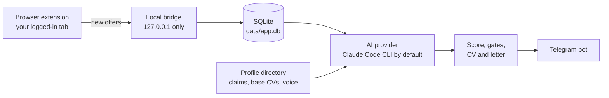

# lazyhunt

A self-hosted job-search assistant: it watches the job portals you choose, scores each new offer against your own verified profile, and drafts a tailored CV and cover letter, all from Telegram.


lazyhunt runs on your own machine. A browser extension reads job searches in your own logged-in browser tab, a local bot judges every new offer with the AI provider you configure (by default your own [Claude Code](https://docs.anthropic.com/en/docs/claude-code) CLI), and Telegram is the only interface. Everything it knows about you comes from a profile directory of facts you wrote and approved; it never invents experience.

> [!IMPORTANT]
> **Read before enabling anything.**
> - **Portals.** The extension reads pages in your own browser tab, at low volume, only for the portals you enable. Some portals (notably LinkedIn) prohibit automated access or browser extensions in their terms, and your account could be restricted. Every portal is **off by default**; enable only those whose terms you have read and accept, and never redistribute collected listings. You are responsible for compliance.
> - **Claude Code.** lazyhunt never logs you in to Claude and never reads or stores Claude credentials. It runs the official, unmodified `claude` CLI that you installed and authenticated yourself. This is an independent project, not made, endorsed or sponsored by Anthropic; check Anthropic's terms and your plan's usage limits.
> - **Your responsibility.** lazyhunt is a personal tool provided as is, with no warranty (see the [license](LICENSE)). You choose what it searches, what it sends to your AI provider and what you send to employers; review every score, CV and letter before you use it.
> - **Gmail** (optional) is read-only, through an OAuth client you create in your own Google Cloud project. Message bodies are never stored and nothing is sent to the author.

## Contents

- [Features](#features)
- [How it works](#how-it-works)
- [Requirements](#requirements)
- [Quickstart](#quickstart)
- [Configuration](#configuration)
- [Customization](#customization)
- [Usage](#usage)
- [Privacy and security](#privacy-and-security)
- [Project status and limitations](#project-status-and-limitations)
- [Development](#development)
- [Contributing](#contributing)
- [Acknowledgements](#acknowledgements)
- [License](#license)

## Features

- **Portal watching, opt-in per portal.** Adapters for LinkedIn, InfoJobs, Indeed, Tecnoempleo, JobFluent, Manfred, Adzuna and foorilla. Enabling one shows its terms warning and asks the browser for permission to that single domain. Rounds run every 60 minutes by default, with a warning below 30.
- **AI match judging with hard gates.** Each offer gets a 0–100 score and a verdict against your claims database, plus deterministic gates for location, language, eligibility and walls (requirements you cannot back). Requirements you cannot honestly claim stay unmatched by design.
- **Calibration from real outcomes.** Interviews and rejections you record become approved calibration examples (`/calibracion`), so the score learns what actually works for you.
- **Tailored CVs.** A one-page PDF per offer from your own base CVs, in Spanish, English or Catalan, using only facts from your profile.
- **Cover letters from a base letter.** Your approved base letter stays word-for-word; the bot writes only the parts that change per offer (why this company, why this role), researches the company on the web, and shows every fact with its source URL. Details: [docs/cover_letters.md](docs/cover_letters.md).
- **Application tracking.** Statuses, history, follow-up reminders after 10 days of silence, an Excel export and an offline HTML dashboard (`/panel`).
- **Interview prep.** STAR stories built from your profile and a per-offer preparation sheet by interview stage (`/star`, `/prep`).
- **Gmail status proposals (optional).** Recognises replies to applications you sent and asks before recording the new status. Details: [docs/gmail.md](docs/gmail.md).
- **Kill switch.** `/pausa` stops every automatic task (scans, auto-analysis, Gmail) and survives restarts; `/reanudar` resumes. The extension has the same button.

## How it works



1. The extension checks your saved searches on enabled portals and sends offers it has not seen to the bot over a loopback-only endpoint protected by a shared secret.
2. The bot stores each offer, extracts its requirements and judges it against your profile with the configured AI provider.
3. You get a Telegram card with the score, the verdict and buttons for the CV, the cover letter and tracking.

## Requirements

- Python 3.12 and [uv](https://docs.astral.sh/uv/)
- One AI provider:
  - **[Claude Code](https://docs.anthropic.com/en/docs/claude-code)** installed and logged in (default), or
  - an Anthropic API key, or any OpenAI-compatible endpoint (see [docs/providers.md](docs/providers.md))
- A Telegram bot token from [@BotFather](https://t.me/BotFather) and your numeric Telegram user id
- Chrome or another Chromium browser, kept open while scans run

## Quickstart

```bash
git clone <this repository> lazyhunt && cd lazyhunt
uv sync
uv run cli.py init   # interactive setup, safe to re-run
uv run bot.py
```

`cli.py init` checks Python, `uv` and that `claude` is installed and logged in, asks for your Telegram bot token (hidden) and numeric user id, generates the bridge secret, and creates a profile directory (`profiles/me`, gitignored) from a placeholder skeleton or from the fictional demo profile. It shows a summary and writes nothing until you confirm: secrets go to `.env` only (mode 600), settings to `config.local.toml`, and existing values are never replaced without asking. Gmail stays off; see [docs/gmail.md](docs/gmail.md).

Then load the extension:

1. Open `chrome://extensions`, turn on **Developer mode**, click **Load unpacked** and select the `extension/` directory.
2. In the extension's Options, set the bridge URL to `http://127.0.0.1:8765/bridge` and paste the bridge secret (`CVA_BRIDGE_SECRET` in `.env`; the wizard can show it once at the end).
3. In **Options › Portals**, enable the portals whose terms you accept, then add your searches.

The step-by-step guide is [docs/getting-started.md](docs/getting-started.md). To configure by hand instead, copy `config.example.toml` to `config.local.toml` and `.env.example` to `.env` and edit them. To try it without your own data, point `profile_dir` at the bundled fictional profile (`profiles/demo`). Running it as a service is covered in [deploy/README.md](deploy/README.md).

## Configuration

Settings are layered: code defaults, then `config.toml`, then `config.local.toml` (personal, gitignored), then `CVA_*` environment variables. Secrets are read from the environment only. [`config.example.toml`](config.example.toml) documents the safe public defaults.

| Setting | Default | What it does |
| --- | --- | --- |
| `llm_provider` | `claude_code` | `claude_code`, `anthropic` or `openai_compatible` ([docs/providers.md](docs/providers.md)) |
| `profile_dir` | unset | Directory with your claims, base CVs, voice and preferences |
| `enabled_portals` | unset | Restrict which portals the bot accepts; unset lets the extension decide |
| `match_mode` | `keyword` | `hybrid` lets the AI judge drive notifications |
| `threshold` | `65` | Minimum score for the top-choice badge |
| `gmail_enabled` | `false` | Optional read-only Gmail sync ([docs/gmail.md](docs/gmail.md)) |
| `paused` | `false` | Initial state of the kill switch until `/pausa` or `/reanudar` is used |

Adding a portal adapter is described in [docs/portals.md](docs/portals.md). How the pieces fit together is in [docs/architecture.md](docs/architecture.md), and the reasons behind the main design choices are in the [architecture decision records](docs/adr/).

## Customization

Everything that describes you or your search is yours to change; none of it needs code. `<profile>` is your profile directory (`profiles/me` after `cli.py init`), and the fictional [`profiles/demo`](profiles/demo) shows every file's format.

| To change | Where | Notes |
| --- | --- | --- |
| Searches: keywords, location, portals | Extension › Options › Auto searches | One search runs on every portal you enabled |
| Title filters (include / exclude) | Extension › Options › Title filters | A cheap pre-filter before the AI sees an offer; can be turned off per search |
| How the AI judges offers for you | `<profile>/judge/facts.md`, `anchors.md`, `rubric_persona.md` | Plain text: facts about you, a few example offers with the score you would give, and how to weigh requirements. `cli.py init` creates them with instructions |
| Your experience (the only source for CVs and letters) | `<profile>/claims.json`, `<profile>/masters/`, your base CVs | A claim that is not here never appears in a CV or a letter |
| Cover-letter voice and emphasis | `<profile>/voice.md`, `<profile>/preferences.toml` `[cover_letter]` | |
| AI provider and model | `llm_provider` in `config.local.toml`; the API key in `.env` | Your own Claude Code login (default, no key), an Anthropic API key, or any OpenAI-compatible endpoint: [docs/providers.md](docs/providers.md) |
| Score threshold, match mode, accepted portals | `config.local.toml` | See [Configuration](#configuration) |
| A portal that is not supported yet | Ask a coding agent | Open `claude` in the repository and say "add portal <name>" with a saved results page: the [`add-portal`](.claude/skills/add-portal/SKILL.md) skill scaffolds the adapter and its tests with `scripts/new_portal.py`. By hand: [docs/portals.md](docs/portals.md) |

## Usage

Everything happens in Telegram; `/help` lists every command with an example. The most used ones:

| Command | Purpose |
| --- | --- |
| `/analyze [url]` | Score an offer by link or pasted text |
| `/cv <id> [AI\|BACKEND] [es\|en\|ca]` | Generate the tailored CV PDF |
| `/status [id]` | Latest offers, or one offer's status |
| `/sent <id>` · `/outcome <id>` | Record an application and its progress |
| `/panel` | Offline HTML dashboard |
| `/prep <id>` · `/star` | Interview preparation |
| `/pausa` · `/reanudar` | Pause or resume every automatic task |

The same service is scriptable from the command line:

```bash
uv run cli.py --help
uv run cli.py analyze <id>
uv run cli.py judge-eval      # measure the judge against labelled offers
```

## Privacy and security

- **Local first.** Offers, scores and history live in a local SQLite database; the bridge listens on `127.0.0.1` only and rejects requests without the shared secret.
- **What leaves your machine:** offer text and the relevant parts of your profile go to the AI provider you configured; card text goes to Telegram; company research uses public web pages; Gmail is read only if you enable it.
- **Secrets** (`CVA_TELEGRAM_TOKEN`, `CVA_BRIDGE_SECRET`, API keys) are read from the environment only; values placed in TOML files are ignored.
- **No accidental API billing.** The `claude` child process does not inherit `ANTHROPIC_API_KEY` unless you set `claude_code_pass_api_key = true`.
- **Revoking access:** delete the Gmail token file and remove the app at [myaccount.google.com/permissions](https://myaccount.google.com/permissions); revoke the Telegram token with BotFather; remove portal permissions from the extension's Options.

## Project status and limitations

lazyhunt is an early release (`v0.1.0`) and was built first for one user's job search in Spain.

- The Telegram interface is in Spanish today; English is planned.
- Location rules ship for Catalonia and Spain; other regions need their own data.
- CV variants are fixed to three role families (AI, Data Science, Backend Python; Spanish and English, plus Catalan for AI). User-defined role families are planned.
- Portal adapters depend on each site's page structure and can break when a site changes.
- AI scores are not deterministic; the gates and the calibration set keep them consistent, not exact.
- The setup wizard (`cli.py init`) covers the first configuration; finer settings are edited by hand (see [Configuration](#configuration)).
- The CV engine renders with Carlito (SIL OFL 1.1, metric-compatible with Calibri), shipped in `cvgen/fonts/carlito/`. If you own Microsoft's Calibri, put `calibri.ttf`, `calibrib.ttf`, `calibrii.ttf` and `calibriz.ttf` in `cvgen/fonts/` and set `cv_font = "calibri"`; Calibri is never redistributed.

## Development

```bash
uv run pytest -q                                   # test suite, no network needed
uv run mypy --strict cva                           # type checking
uv run ruff check cva tests bot.py cli.py scripts  # lint
```

Tests use fake AI clients and temporary directories; none of them call a real provider, portal or Telegram.

Design notes: [docs/architecture.md](docs/architecture.md) (components and data flow) and [docs/adr/](docs/adr/) (decision records: browser extension, Claude Code CLI, SQLite, bring-your-own OAuth client, opt-in portals).

## Contributing

Issues and pull requests are welcome. Please open an issue first for larger changes, keep each pull request focused, and include tests: the suite, `mypy --strict` and `ruff` must pass. Never commit personal data, saved portal pages, tokens or credentials.

## Acknowledgements

- [ai-job-search](https://github.com/MadsLorentzen/ai-job-search) by Mads Lorentzen for the portal-adapter and profile-driven search ideas (MIT).
- [linkedin_beacons](https://github.com/Edugs94/linkedin_beacons) by Edugs94, the browser extension the first versions of `extension/` were built on; version 2.0 is a clean-room rewrite (see [extension/PROVENANCE.md](extension/PROVENANCE.md)).
- [python-telegram-bot](https://github.com/python-telegram-bot/python-telegram-bot), [pydantic](https://github.com/pydantic/pydantic), [fpdf2](https://github.com/py-pdf/fpdf2), [httpx](https://github.com/encode/httpx) and [uv](https://github.com/astral-sh/uv).

## License

[Apache-2.0](LICENSE) © lazyhunt contributors.
