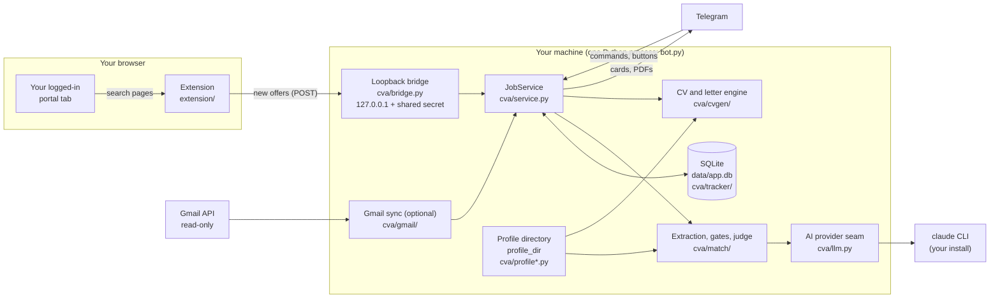

# Architecture

lazyhunt is one Python process (the Telegram bot) plus a browser extension,
both on your own machine. There is no server, no account and no shared
backend: data stays in a local SQLite file and leaves the machine only for
the AI provider you configured, Telegram and, if enabled, Gmail.

## Components and data flow

1. **Extension** (`extension/`). On a schedule (60 minutes by default) it
   opens your saved searches for the portals you enabled, in your own browser
   session, and reads the result pages. Portal adapters live in
   `extension/portals/`; the round, scheduling and delivery logic in
   `extension/core/`. Offers it has not delivered yet are POSTed to the bot.
2. **Bridge** (`cva/bridge.py`). A stdlib HTTP server on `127.0.0.1` only,
   started by `bot.py` when `CVA_BRIDGE_SECRET` is set. Requests without the
   shared secret are rejected; with the secret unset no port is bound.
3. **Service** (`cva/service.py`). `JobService` is the single seam every
   entry point uses: `bot.py` (Telegram) and `cli.py` (command line) are thin
   shells over it.
4. **Storage** (`cva/tracker/`). Offers, scores, judgments, statuses and
   history live in `data/app.db` (SQLite, schema in
   `cva/tracker/schema.sql`). The `/panel` HTML dashboard and the Excel export
   are built from it (`cva/report/`, `cva/tracker/xlsx.py`).
5. **Matching** (`cva/match/`). The AI provider extracts requirements;
   deterministic gates (location, language, eligibility, stack walls) and the
   scorer run locally; the AI judge gives the 0-100 score and verdict against
   your claims. Calibration examples from real outcomes feed the judge
   (`cva/calibration.py`).
6. **AI provider** (`cva/llm.py`). One protocol, three implementations:
   your own `claude` CLI (default, run as a child process without your API
   keys), the Anthropic API, or an OpenAI-compatible endpoint. See
   [providers.md](providers.md).
7. **Profile directory** (`profile_dir`, resolved by
   `cva/profile_paths.py`). Claims, synonyms, master CVs, base PDFs, voice
   sample, preferences and the judge's persona text. Nothing about the user
   is hard-coded; `profiles/demo` is a complete fictional example.
8. **CV and letters** (`cva/cvgen/`, `cva/match/cover_letter.py`). One-page
   PDFs rendered locally from your masters, using only claims from your
   profile.
9. **Telegram** (`bot.py`, `cva/notifier.py`, `cva/commands.py`). Long
   polling only: no webhook and no public endpoint. The bot answers only
   `owner_telegram_id`. Scheduled jobs run in the bot's job queue
   (`cva/scheduler.py`).
10. **Gmail** (`cva/gmail/`, optional, off by default). Polls replies to your
    applications with `gmail.readonly`, classifies them and asks you in
    Telegram before changing a status.

## Configuration and setup

- `cva/config.py`: settings layered as code defaults, `config.toml`,
  `config.local.toml`, then `CVA_*` environment variables. Secrets come only
  from the environment or `.env`.
- `cva/setup/wizard.py`: `uv run cli.py init`, the first-run wizard (see
  [getting-started.md](getting-started.md)).

## Trust boundaries

| Boundary | Protection |
| --- | --- |
| Extension to bot | loopback address only, shared secret, portal allowlist (`enabled_portals`) |
| Bot to Telegram | bot token from the environment; single-owner filter |
| Bot to AI provider | your own CLI login or key; `ANTHROPIC_API_KEY` not passed to `claude` unless opted in |
| Bot to Gmail | your own OAuth client, read-only scope, token file mode 600 |
| Kill switch | `/pausa` stops scans, automatic analysis and Gmail and survives restarts |

## Decisions

The reasons behind the main choices are recorded as ADRs in [adr/](adr/):

- [0001](adr/0001-browser-extension-in-the-users-tab.md) Browser extension in your own tab instead of server-side scraping
- [0002](adr/0002-users-own-claude-code-cli-as-default-provider.md) Your own Claude Code CLI as the default provider
- [0003](adr/0003-sqlite-local-storage.md) SQLite local storage
- [0004](adr/0004-bring-your-own-google-oauth-client.md) Bring-your-own Google OAuth client for read-only Gmail
- [0005](adr/0005-portals-opt-in-with-terms-warnings.md) Portals opt-in, with terms warnings and per-domain permission
